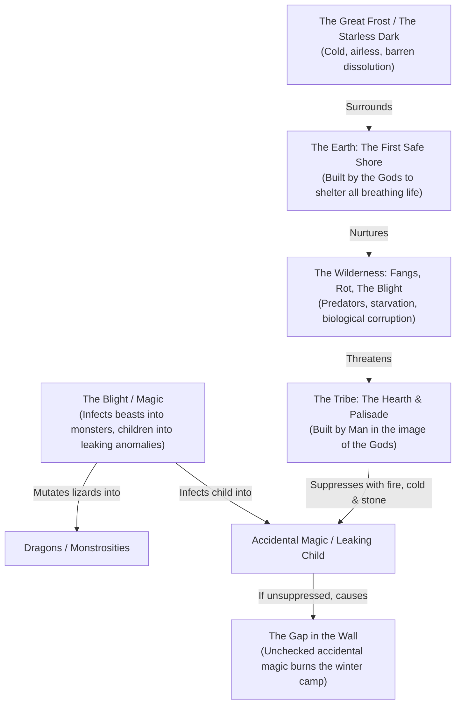

# Theological Notes: Pillar 1 — Mythos & The Primal Sanctuary

**Classification:** Canonical Mythological Core (Locked)  
**Repository:** [`wbc-library/01_theological_compendium/vesselist_doctrine/`](https://github.com/ImmortalWiz/wbc-library/tree/main/01_theological_compendium/vesselist_doctrine)  
**Parent Engine:** [Harry Potter and the Magical Reality Check (`SUBVERTED_HARRY`)](https://github.com/ImmortalWiz/harry-potter-and-the-magical-reality-check)  
**Setting Horizon:** Paleolithic-Neolithic Tribal Threshold (The First Walls)

---

## 1. The Four Foundational Tenets

### Tenet A: Primitive, Anthropological Vocabulary
* **No Abstractions:** The sacred text strictly avoids modern abstractions like "entropy," "thermodynamics," or "intelligence."
* **The Primal Categories:** The world is understood through raw, sensory realities:
  * **The Fire / The Hearth:** Life, warmth, sworn kinship, predictability.
  * **The Great Frost / The Dark Outside:** The freezing void beyond the sky, predatory beasts, starvation.
  * **The Vulnerability Outside:** To be outside the perimeter is death.
  * **The Supremacy of the Human Animal:** Humans are the supreme beasts, masters of predator and prey through collective organization, speech, and crafted stone/wood tools.

### Tenet B: Accidental Magic as the Primal Terror
* **The Root Catalyst:** At the dawn of the tribe, there were no wands, schools, or formal spellcraft. There was only **accidental magic**—violent, unpredictable biological anomalies.
* **The Clan's Existential Threat:** When a child suddenly leaks fire without flint, makes food rot with a touch, or manifests impossible physical warps, the survival of the fragile winter camp is endangered.
* **The Religion as Immune Response:** The faith arose as a life-or-death communal defense system: to isolate, suppress, purge, or beat the unnatural warp out of the afflicted before the whole shelter was destroyed.

### Tenet C: The Nested Sanctuaries (The Human Mirror of the Gods)
* **The First Sanctuary (Cosmic):** The Gods made the Earth as a round, bounded shore against the black, freezing, airless void of the cosmos, protecting all natural life.
* **The Second Sanctuary (Tribal):** In the image of what the Gods did with Earth, humans (the supreme animal) built **The Tribe**: four posts in the ground, a thatched roof, and a central hearth to shelter themselves from fangs, winter, rot, and the Blight.
* **The Tragic Limit:** Humans are *not* gods. The tribe’s protection is finite and fragile. It holds only as long as every member maintains fierce discipline, physical labor, and vigilance over the perimeter.

### Tenet D: The Parasite Attacks All Life (Biological Mutation)
* **Not Just a Human Mind Disease:** The Blight (magic) infects **life itself**. It is an unnatural, cosmic contagion that mutates and corrupts normal physical creatures:
  * A **dragon** is not a sacred creature; it is a common lizard bloated and diseased by the infection until it leaks fire from its gut.
  * A **basilisk** is a corrupted serpent.
  * When it strikes a **human child**, the child becomes an abnormal, leaking mutant that threatens the pack.

---

## 2. The Architectural Metaphor of the Canon

---

## 3. Sample Canonical Verse (*Canticle I: The Two Enclosures*)

> **1:1** In the outer dark where the sun goeth not, there is neither marrow nor breath; only the Great Frost that hungereth for meat.  
> **1:2** And the Shaper of Old laid down the Earth like an island between the waters and the sky, and gave her grass, and beasts of the field, and boundaries that do not wander.  
> **1:3** And Man was the cunning animal among the herds; and Man saw that the night had teeth, and the cold was swift.  
> **1:4** Therefore Man did what the Shaper did: he drove four stakes into the silt, and built the round hearth, and called his brothers to the fire.  
> **1:5** The Earth is the pen of the Gods against the sky; the Tribe is the pen of Man against the beast.  
> **1:6** But the creeping Blight falleth upon the grass. It toucheth the lizard of the stones, and he swelleth into the great worm that vomiteth fire; it toucheth the son of the hunter, and his fingers spit unnatural heat without wood.  
> **1:7** If the father pity the leaking son, the thatch taketh flame in the night; and the frost cometh through the ash, and the pack dieth together.
