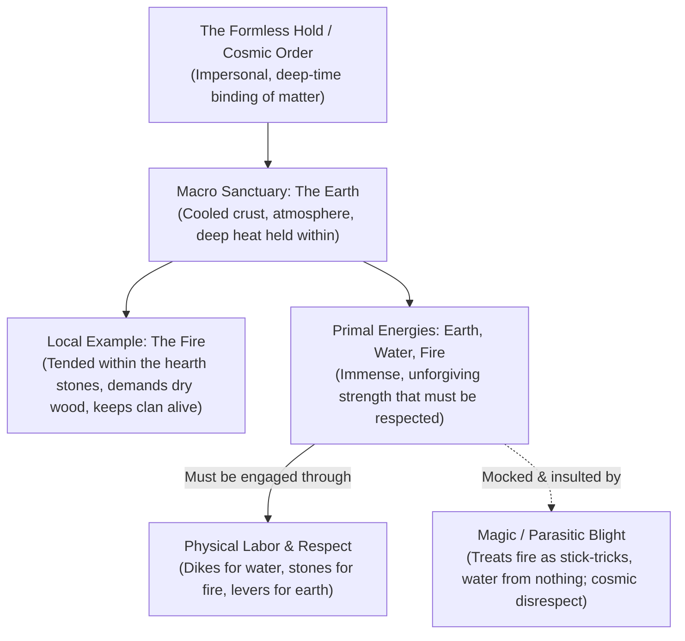

# Theological Notes: Pillar 1 — Mythos & The Primal Sanctuary

**Classification:** Canonical Mythological Core (Locked)  
**Repository:** [`wbc-library/01_theological_compendium/vesselist_doctrine/`](https://github.com/ImmortalWiz/wbc-library/tree/main/01_theological_compendium/vesselist_doctrine)  
**Parent Engine:** [Harry Potter and the Magical Reality Check (`SUBVERTED_HARRY`)](https://github.com/ImmortalWiz/harry-potter-and-the-magical-reality-check)  
**Setting Horizon:** Paleolithic-Neolithic Tribal Threshold (The First Hearths)

---

## 1. The Core Cosmic Cosmology: Deep Time & The Formless God

### 1.1 "God" as The Formless Hold (Order Itself)
* **Non-Humanoid Reality:** God is not an anthropomorphic ruler, an old man in the sky, or a craft-god with human hands and ego.
* **The Cosmic Definition:** God is **The Hold / The Bind / The Great Grip (The Formless Order)**—the silent, omnipresent, unyielding physical current that resists cosmic dispersal, pulls matter into form, and upholds physical causality.
* **The Anti-Thesis:** **The Great Scatter / The Dissolving / The Drift (Entropy)**—the cold, airless, infinite vacuum that perpetually seeks to disperse all heat, dissolve all bonds, and return reality to dead, uniform silence.

### 1.2 Deep Time: The Agonizing Sediment (14B Universe, 4.5B Earth)
* **No Instant Magical Creation:** The Earth was not poofed into existence in a week.
* **The Astronomical Struggle:** Through uncounted ages—astronomical deep time that human language can only fathom as *"darknesses beyond reckoning"*—The Hold ground against The Scatter. It gathered the drifting stellar ash, compressed the core, and slowly cooled a planetary crust.
* **Earth as the Macro-Sanctuary:** Earth is the hard-won sediment of billions of years of silent, physical pressure—a rare, fragile, low-entropy anchorage in a hostile cosmos where atmosphere, liquid water, and biological breath can endure.

---

## 2. The Twin Cheats: Prayer and Magic

In this theology, **conventional prayer and magical casting are the exact same moral corruption**:

| Pathway | The Mechanism | Moral Classification |
| :--- | :--- | :--- |
| **Conventional Prayer** | Begging an outside entity to bypass physical causality and deliver an unearned result without physical labor. | **The Coward's Cheat** (Spiritual parasitism). |
| **Magical Casting** | Using an occult shortcut to bypass physical causality and manifest an effect without physical energy/collateral. | **The Sorcerer's Cheat** (Cosmic breach). |
| **The Holy Path: Physical Labor** | Exerting muscle, calories, breath, and crafted tools against raw matter. Paying the full energetic debt in sweat. | **The Only True Devotion** (Alignment with The Hold). |

> *"You do not pray for the timber to rise; you fell the oak, you rig the hemp, you call your brothers, and you lift with your back. The universe honors the weight, not the whine."*

---

## 3. Primal Energies: The Earth and The Fire

The religion commands absolute reverence for the raw, unforgiving strength and energy of natural elements:

### 3.1 Earth as the Macro-Sanctuary
* The Earth is the macro-hearth. It holds the boiling fires deep within its belly while presenting a cold, stable crust upon which creatures can tread.
* It demands that all who walk upon it respect gravity, distance, and the seasons.

### 3.2 Fire as the Local, Living Example
* **The Living Teacher:** Fire is the immediate, tangible teacher of cosmic law in the camp.
* **The Contract of Fire:** Fire gives warmth, light, and cooking, but it operates under strict, non-negotiable physical laws:
  * It demands dry wood and oxygen.
  * It must be kept bounded within a ring of hard stones.
  * If fed and tended with discipline, it saves the clan from the freezing dark.
  * If neglected, disrespected, or allowed to leap the stones, it consumes the shelter and burns the forest to ash.
* **Respecting Primal Strength:** You cannot negotiate with fire, flood, or stone. You build dikes for water, you gather fuel for fire, and you use rollers for stone. 
* **Magic’s Sacrilege:** Magic treats fire as a parlor trick to flick from a stick without fuel, conjures water from thin air without rain, and ignores the weight of stone. By treating primal energies with flippant disrespect, magic invites catastrophic backlashes.

---

## 4. The Parasite and Accidental Magic

* **The Vector of Infection:** The Blight (magic) infects life itself across all species. It turns ordinary lizards into fire-swollen dragons and serpents into basilisks.
* **The Early Clan's Terror:** Accidental magic in early human children was recognized as the ultimate domestic hazard. A child suddenly leaking fire without wood or turning milk to poison threatened to break the hearth’s ring of stones and destroy the entire winter settlement.
* **Communal Duty:** The suppression and cleansing of the anomaly is an act of pack-preservation: enforcing the ring of stones so the wild dark cannot enter.
