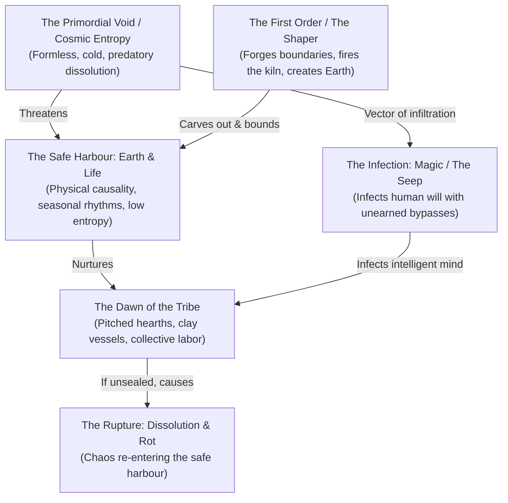

# Theological Notes: Pillar 1 — Mythos & The Entropic Conflict

**Classification:** Working Theological Notes / Canonical Design  
**Repository:** [`wbc-library/01_theological_compendium/vesselist_doctrine/`](https://github.com/ImmortalWiz/wbc-library/tree/main/01_theological_compendium/vesselist_doctrine)  
**Parent Engine:** [Harry Potter and the Magical Reality Check (`SUBVERTED_HARRY`)](https://github.com/ImmortalWiz/harry-potter-and-the-magical-reality-check)  
**Pillar:** Pillar 1 (Mythos / Cosmogony)

---

## 1. Core Premise (The Seed of Ideation)

> *"The core is conflict between order and chaos (because the religion was at the onset of tribe society). Entropy is the antithesis of life in this theology. And magic is viewed as the tool infecting the most intelligent of life forms to bring on chaos to the safe harbour of life: Earth."*

---

## 2. Anthropological & Historical Context: The Tribal Dawn

* **The Onset of Tribal Society:** The religion was not born in advanced urban empires, but in the fragile dawn of settled tribal life (the Neolithic / early Bronze threshold).
* **The Existential Reality of the Early Tribe:**
  * To the early human tribe, **survival was a constant, exhausting war against dissolution**.
  * The wild, predatory nature outside the palisade, the spoiling of grain, the freezing winter, the collapse of unbaked mud walls, and internal lawlessness were all manifestations of a single cosmic enemy: **Dissolution / Chaos**.
  * Gathering by the hearth, building stone walls, firing clay vessels, and binding humans into sworn kinship was the first holy act: **carving an island of Order out of the boundless wilderness**.

---

## 3. Metaphysics: Entropy as the Antithesis of Life

In this theological system:
* **The Void / Entropy:** The universe's default, unthinking tendency toward coldness, dispersion, formlessness, and rot. It is the unmade silt, the solvent that hates walls.
* **Life as Defiant Resistance:** Life is not a passive accident; it is the active, miraculous holding of low-entropy form against the universal drift. Life requires continuous expenditure of energy, friction, sweat, and containment to maintain its boundaries.
* **Earth as the Safe Harbour:** The material physical world (Earth) is understood as a sacred, fortified anchorage—a sheltered harbor in a cosmos of swirling, indifferent chaos. Here, stable physical laws, biological growth, and tangible cause-and-effect provide a sanctuary where life can endure.

---

## 4. The Theological Diagnosis of Magic: The Vector of Chaos

Unlike fantasy cosmologies where magic is a benevolent blessing, divine spark, or neutral tool, this theology diagnoses magic with terrifying clarity:

1. **The Cosmic Infection:**
   * Magic is an entropic parasite—an alien, solvent force seeking to breach and dissolve the safe harbour of physical reality.
2. **Targeting the Most Intelligent Life Form:**
   * Magic specifically infects humanity because humans are the cognitive keystone of Earth's order. Human intelligence is the only faculty capable of either upholding the safe harbour through discipline and law, or tearing it open through hubris.
3. **The Seduction of the Unearned Shortcut:**
   * Magic tempts the intellect by offering **effects without physical causality, motion without muscular effort, heat without fire, and increase without labor**.
   * It tells the human: *"You need not sweat; you need not endure the kiln; you can bypass the stone."*
4. **The Structural Cost:**
   * Every magical act is an unmeasured puncture in the harbor's wall. When a human channels magic, they are not creating power; they are letting the cosmic solvent seep through their nervous system into the physical world, bringing forward the heat-death and chaotic collapse of reality.

---

## 5. Structural Impact on *The Book of the Shaper*

This ideation directly establishes the narrative arc for **Canticle I of the Canon**:

* **The Primal Mandate:** Humanity’s sacred duty is not conquest, but **stewardship of the seal**—maintaining the low-entropy sanctuary against the rot of the void.
* **The Saintly Ideal:** The builder, the smith, the tilled field, the sealed pot, the disciplined body.
* **The Abomination:** The witch, the sorcerer, the unworked miracle, the leaking vessel.
